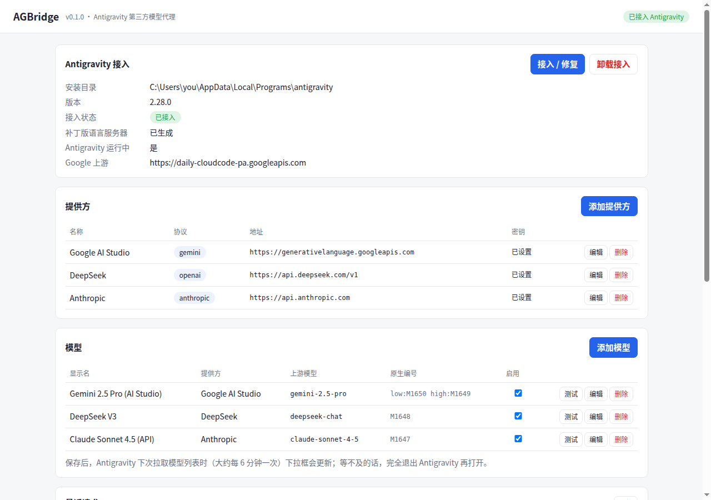

# AGBridge

**Add third-party models to the Antigravity desktop app. They show up in the same model picker as the subscription models, and you can switch between them at any time.**

[](https://github.com/anlidy/agbridge/actions/workflows/test.yml)
[](https://github.com/anlidy/agbridge/releases/latest)
[](LICENSE)

[简体中文](README.md) | English



- **Three upstream protocols**:
  - The native Gemini API, from Google AI Studio or any relay that speaks it.
  - OpenAI-compatible APIs: DeepSeek, OpenRouter, SiliconFlow, Alibaba Bailian, a local Ollama…
  - Anthropic Messages.
- **The native picker**: third-party models are switched like Gemini or Claude, including the Low / Medium / High thinking switch that native Gemini models have.
- **Subscription models are untouched**: unless a third-party model is selected, every request goes to Google as is.
- **One exe**: it sits in the tray and is configured from a browser console. Antigravity starts it on demand.
- **Antigravity's own code stays unchanged**: AGBridge swaps one executable, restores it with one click, and re-applies itself after Antigravity updates.

> The console UI is in Chinese for now. The steps below name each button.

## Download

Get `agbridge.exe` from [Releases](https://github.com/anlidy/agbridge/releases/latest).

Requirements:

- Windows 10 / 11 x64.
- The Antigravity **desktop app**, i.e. the standalone Antigravity application, not the VS Code based Antigravity IDE.
- Tested with versions 2.25.0 and 2.28.0.

The exe is not code-signed, so SmartScreen may warn on first run ("More info → Run anyway"). You can also [build it yourself](#build-from-source).

## Quick start

1. **Run AGBridge.** Put `agbridge.exe` somewhere permanent first, e.g. `%LOCALAPPDATA%\Programs\agbridge\`, because Antigravity will launch it from that path. Moving it later is fine: run it once by hand and it updates the path. A tray icon appears and the console opens at `http://127.0.0.1:50999/ui/`.
2. **Add a provider (添加提供方).** Pick the protocol, then enter the Base URL and API key.

   | Protocol | Base URL example | Notes |
   | --- | --- | --- |
   | `gemini` | `https://generativelanguage.googleapis.com` | Use a [Google AI Studio](https://aistudio.google.com/apikey) key, or a relay's domain; `/v1beta` is added automatically. Pick the auth mode the relay expects (认证方式): `x-goog-api-key` header, Bearer, or `?key=`. |
   | `openai` | `https://api.deepseek.com/v1`, `https://openrouter.ai/api/v1`, `http://127.0.0.1:11434/v1` (Ollama) | Up to `/v1`; AGBridge calls `…/chat/completions`. |
   | `anthropic` | `https://api.anthropic.com` | AGBridge calls `…/v1/messages`. |

3. **Add a model (添加模型).** You can fetch the provider's model list and tick several models at once (从提供方获取模型列表), or type the upstream model name yourself. After saving, press **测试** (test) to check that the model answers.
4. **Hook into Antigravity (接入 / 修复).** You can do this while Antigravity is running.
5. **Quit Antigravity completely, including its tray icon, then start it again.** The models are now in the picker. Later changes to models show up without a restart: the language server re-fetches the model list about every 6 minutes.

## Thinking levels

Native Gemini models offer a Low / Medium / High switch in the picker. Behind it are separate catalog entries such as "Gemini 3.8 Flash (Low)" and "(High)", which Antigravity merges into one model.

Tick levels under **下拉框档位** in a model's settings, and AGBridge adds one entry per level the same way. Each level is sent upstream as:

- Gemini: `thinkingLevel`.
- OpenAI-compatible: `reasoning_effort`.
- Anthropic: an extended thinking budget.

Not every model supports every level; Gemini 4 Argon, for example, rejects Minimal.

## Troubleshooting

- **No third-party models in the picker.**
  - The console's 接入状态 should read 已接入 (hooked).
  - 最近请求 (recent requests) should list 模型列表 (model list) fetches. If there are none, Antigravity has not been restarted since hooking.
- **"Agent execution terminated due to error".** The failed request in 最近请求 shows the upstream's own error message, e.g. a bad key, a wrong model name or no quota left. Third-party 401/403/404 responses are turned into 400, so Antigravity never mistakes them for an expired Google login.
- **Models gone after an Antigravity update.**
  - Updates replace the whole install folder. A running AGBridge re-hooks within seconds.
  - Antigravity restarts itself right after updating, still on the stock language server, so restart it once more.
- **Does AGBridge have to be running?** No. The hooked language server starts it in the background when needed. If that fails, Antigravity runs its stock language server: it still works, just without third-party models.

## Uninstall

Press **卸载接入** (unhook). The stock `language_server.exe` is restored and AGBridge's files are removed from the Antigravity folder. Then quit AGBridge and delete `agbridge.exe` and `%APPDATA%\agbridge`. API keys in `config.json` are encrypted with Windows DPAPI.

## How it works

1. **Shim.** AGBridge replaces `resources\bin\language_server.exe` with a small shim. The shim points the Cloud Code endpoint flags at `127.0.0.1:50999` and starts the real language server. Stdio and the exit code pass straight through.
2. **Patched copy.** The model-list URL is hardcoded in the binary and ignores the flags. AGBridge therefore runs a copy in which that URL is replaced by a local one of the same length.
3. **Catalog injection.** The proxy adds the custom models to `fetchAvailableModels`. Each one takes an unused `MODEL_PLACEHOLDER_M<n>` slot, avoiding the slots Google uses.
4. **Generation.** When a custom model is selected, the proxy translates its generations to the upstream protocol. Everything else is forwarded to Google.
5. **Changes while running.** Windows won't overwrite a running exe but lets it be renamed. Hooking, unhooking and auto-repair rename files in use out of the way, so they all work while Antigravity is running.
6. **Auto-repair.** After an update, AGBridge waits until the new language server is fully written (up to its signature table) before hooking it again.

## Limitations

- Tested only with the Windows desktop app 2.25.0 and 2.28.0.
- Antigravity's WSL mode runs the language server inside WSL, so the shim is bypassed.
- Agent tool use depends on how well the upstream model handles function calling.
- Background tasks such as checkpoint summaries still use Antigravity's built-in models.
- This uses unofficial, internal Antigravity interfaces, which may break with any update. Whether it fits Google's terms of service is for you to judge.

## Build from source

Requires Go 1.27+. Cross-compiles from Linux, macOS or Windows (Git Bash):

```bash
./build.sh            # builds the shim, then dist/agbridge.exe with the shim embedded
go test ./...
```

On non-Windows systems `go run ./cmd/agbridge serve` runs headless, which is handy for working on the proxy and the console. `AGBRIDGE_HOME` selects another config folder.

## Credits

- [vahapogut/antigravity-add-model](https://github.com/vahapogut/antigravity-add-model): the catalog entry format and placeholder allocation.
- [YashjitPal/BetterGravity](https://github.com/YashjitPal/BetterGravity): how catalog thinking budgets map to thinking levels.

## License

[Apache-2.0](LICENSE). Not affiliated with Google. Antigravity is a Google product.
